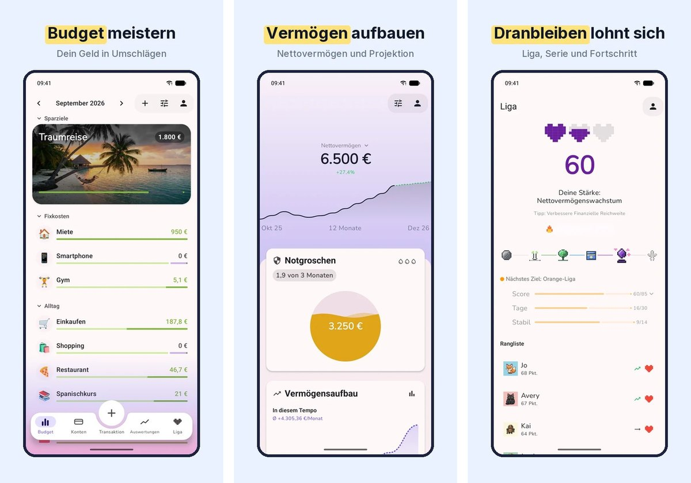
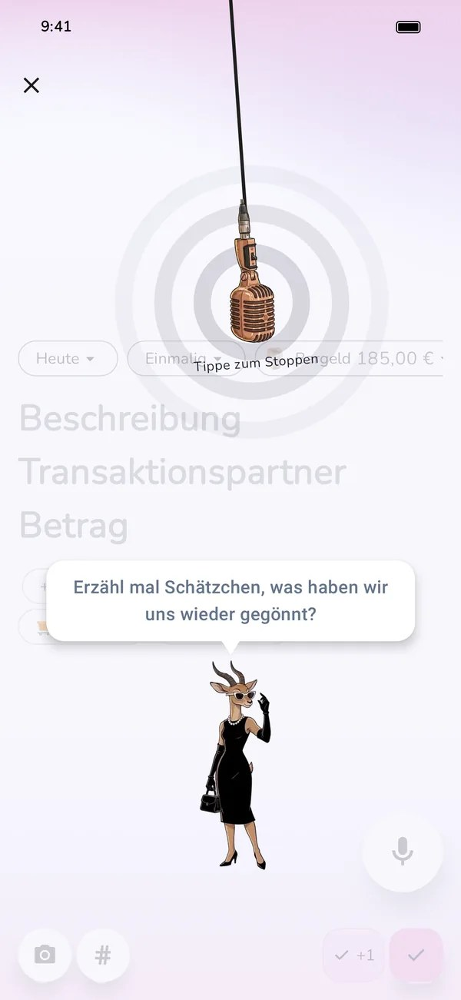
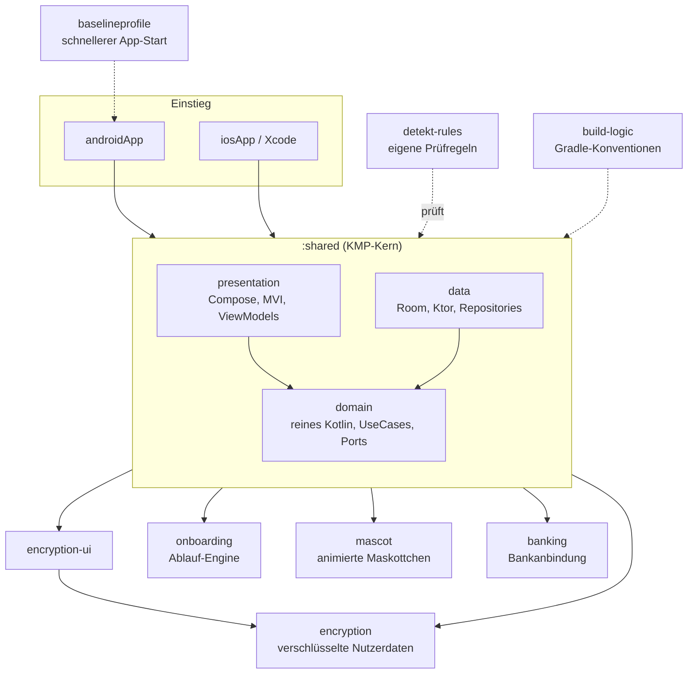

<p align="center">
  
</p>

# Hallo, ich bin Michael 👋

**Android-Entwickler, der Produkte von der ersten Idee bis zum zahlenden Kunden denkt.**
Rund acht Jahre App-Entwicklung, zuletzt allein verantwortlich für eine komplette App: von der passenden Architektur, noch vor der ersten Codezeile, bis zum zahlenden Kunden.

💼 [LinkedIn](https://www.linkedin.com/in/michaelhofmann-dev/) · 🌐 [getalife.app](https://getalife.app)

---

## Was ich in ein Team einbringe

| Ihr Nutzen | Konkret |
|---|---|
| 🏗️ **Saubere Grundlage statt Altlast** | Ich lege Architektur und Modulstruktur fest, bevor Code entsteht. Das spart später Zeit, Geld und Nerven. |
| 🚀 **Ganze Verantwortung** | Von der Idee über Entwicklung und Tests bis zum Store-Auftritt. Ich arbeite selbstständig und bringe Dinge ins Ziel. |
| 🛡️ **Qualität ist automatisiert** | Tests und Prüfregeln laufen bei jeder Änderung von selbst. Fehler fallen auf, bevor Nutzer sie sehen. |
| 🤖 **KI als Werkzeug, nicht als Zufall** | Ich arbeite täglich mit Claude Code, geführt von eigenen Regeln für Architektur, Tests und Clean Code. Das macht mich schneller, ohne an Qualität zu sparen. |

---

## Mein Showcase: GetALife

**GetALife** ist meine eigene Budget-App. Sie hilft Menschen, jeden Euro einzuplanen (Zero-Based-Budgeting), und macht daraus ein Spiel, bei dem man gern dranbleibt.
Ich habe sie komplett allein gebaut: App, Server-Funktionen, Website, Store-Auftritt und ein internes Steuerungs-Cockpit.

> **Stand:** Android in **offener Beta bei Google Play**, iOS läuft über TestFlight, **bald im App Store**.

<p align="center">
  <a href="https://play.google.com/store/apps/details?id=app.tinygiants.getalife"><b>▶ Open Beta bei Google Play</b></a>
  &nbsp;·&nbsp;
  <a href="https://getalife.app"><b>🌐 Website</b></a>
</p>

<p align="center">
  
</p>

<table>
  <tr>
    <td width="50%" valign="top">
      
      <br><sub><b>Sparziele</b> als Polaroids: Man sieht, wofür man spart.</sub>
    </td>
    <td width="50%" valign="top">
      
      <br><sub><b>Buchen per Sprache:</b> sprechen statt tippen.</sub>
    </td>
  </tr>
</table>

<p align="center">
  
  <br><sub>Das Leben kommt mit Rechnungen. GetALife plant sie mit ein.</sub>
</p>

### Was in dem Projekt steckt

- **Eine Codebasis für Android und iOS** mit Kotlin und Compose Multiplatform. Die iOS-spezifischen Teile entstehen KI-gestützt.
- **Verschlüsselte Nutzerdaten** und eine Bankanbindung.
- **20 Sprachen** mit automatischer Vollständigkeitsprüfung.
- **Abo-Modell und Bezahlschranke** in der App, dazu Store-Auftritt (ASO/SEO-Grundlagen in Eigenregie).
- **Eigenes Backoffice** (privat, nur intern): bündelt Geschäftsdaten, überwacht Marketing, Kosten und Roadmap, misst Nutzeraktivität und wertet Experimente bis zum statistischen A/B-Test aus. Ein KI-Agent für Apple Ads arbeitet dort mit festen Budget- und Gebotsgrenzen und einem Not-Aus, ein weiterer KI-Agent (Claude API) erzeugt Store-Grafiken. Die Werbekampagnen selbst sind in Vorbereitung und laufen noch nicht.
- **Öffentlicher MCP-Server** für KI-Assistenten: [mcp-server-getalife](https://github.com/Narazgul/mcp-server-getalife).

> Der Quellcode von GetALife ist privat. Auf Wunsch zeige ich ihn im Gespräch live.

---

## Werdegang in Kürze

| Station | Was ich gemacht habe |
|---|---|
| **GetALife** (seit 03/2024, selbstständig) | Eigene App von Architektur bis Store. Kotlin, Compose Multiplatform, TypeScript für Server-Funktionen. |
| **stock3 AG** (angestellt) | Android-App in Kotlin mit MVVM und RxJava. Play-Store-Bewertung von ca. 3,6 auf bis zu 4,3 gesteigert, Absturzrate deutlich gesenkt, das Shop-System mit Google Play Billing allein umgebaut. |
| **NEXT Munich** (App-Agentur) | Xamarin/C#: ADAC Payment allein auf einem Android-Payment-Terminal, BSPushTan (2-Faktor-Authentifizierung) für die Warburg Bank, Headache Hurts. |
| **Favendo** (Junior) | Einstieg in die professionelle App-Entwicklung. |

---

## Wie ich mit KI arbeite

Ich nutze **Claude Code** jeden Tag. Entscheidend ist, dass die KI nicht frei improvisiert: Ich habe **eigene Skills** geschrieben, die Architektur, Modularisierung, Tests und Clean Code verbindlich vorgeben. Vor jeder Änderung lädt die KI die passenden Regeln, danach prüfen automatische Gates das Ergebnis.

| Skill | Was er festlegt |
|---|---|
| `module-structure` | Modulaufbau, Schichtenregeln, Gradle-Konventionen |
| `data-layer` | Repositories, DTOs, Mapper, Room, Offline-First |
| `presentation-mvi` | ViewModel, UiState, Action, Event |
| `di-koin` | Dependency Injection mit Koin |
| `error-handling` | Typisierte Fehler statt Ausnahmen im Fluss |
| `testing` | Unit-Tests mit Fakes, Turbine, AssertK |
| `compose-performance`, `compose-components`, `compose-design` | Compose-Korrektheit, Bausteine, Gestaltung |
| `navigation` | Typsichere Navigation |

So bleibt der Mensch Architekt und Prüfer, und die KI liefert unter klaren Leitplanken schnell die Handarbeit.

---

## Für Technikerinnen und Techniker

### Tech-Stack


Früher im Einsatz: Java, RxJava, MVVM, Xamarin/C#, Google Play Billing.

### Architektur von GetALife

Ein gemeinsamer Kern (`:shared`) mit Schichten als Pakete, drumherum eigenständige Module für Dinge, die sich isolieren lassen (austauschbarer Anbieter, eigene Prüfung, eigener Build-Zweck).



Die Schichtenregeln sind nicht nur Konvention, der Build erzwingt sie: `presentation` darf nie auf `data` zugreifen, `domain` bleibt reines Kotlin.

### Qualitätspraktiken

- **Architektur-Check** im Build: verbietet unter anderem Repository-Zugriffe in ViewModels, veränderliche Domain-Modelle, frei geworfene Exceptions in UseCases und direkte Uhr-Zugriffe in der Domain (Zeit kommt über einen `DateTimeProvider`).
- **Eigene detekt-Regeln** (mit eigenen Tests), zum Beispiel gegen verschluckte `CancellationException` oder rohe Farbwerte im UI-Code. Dazu Spotless für einheitliche Formatierung.
- **Tests:** über 600 Testdateien, Kern-Logik als JVM-Host-Tests in `commonTest`, ViewModel-Tests mit Turbine, Screenshot-Tests, iOS-Rauchtest.
- **Mehrsprachigkeit als Gate:** `check-i18n` bricht den Release ab, wenn in einer der 20 Sprachen Texte fehlen oder veraltet sind.
- **Quality Gate bei jedem Push** auf einem eigenen Build-Rechner, vor jedem Release zusätzlich die volle Prüfung in der Cloud. Ein Release bricht ab, wenn die Prüfung rot ist.
- **Typisierte Fehler** statt Ausnahmen im normalen Ablauf, UI-Texte über eine eigene `UiText`-Abstraktion.
- **Baseline Profile** für schnelleren App-Start.

### Code-Beispiele aus GetALife

Kleine, unkritische Ausschnitte. Der restliche Quellcode ist privat.

<details>
<summary><b>MVI: ein kleines ViewModel mit UiState</b></summary>

Das ViewModel kennt nur einen UseCase, nie ein Repository. Der Zustand ist ein einziges, unveränderliches Objekt.

```kotlin
data class AppUpdateState(
    val status: AppUpdateStatus = AppUpdateStatus.NotRequired,
    val isDismissed: Boolean = false,
)

class AppUpdateViewModel(
    private val checkAppUpdate: CheckAppUpdateUseCase,
) : ViewModel() {

    private val _state = MutableStateFlow(AppUpdateState())
    val state = _state.asStateFlow()

    init {
        viewModelScope.launch {
            val status = checkAppUpdate()
            _state.update { it.copy(status = status) }
        }
    }

    fun dismissFlexibleUpdate() {
        _state.update { it.copy(isDismissed = true) }
    }
}
```
</details>

<details>
<summary><b>Typisierte Fehler und UI-Texte</b></summary>

Fehler sind geschlossene Typen. Der `when`-Ausdruck im UI wird vom Compiler auf Vollständigkeit geprüft, und die Domain kennt keine Android-Strings.

```kotlin
sealed class DataError(cause: Throwable? = null) : Exception(cause), Error {

    sealed class Network : DataError() {
        data object NoInternet : Network()
        data object RequestTimeout : Network()
        data object Unauthorized : Network()
        data object ServerError : Network()
        data object Unknown : Network()
        // weitere Fälle gekürzt
    }

    sealed class Local(cause: Throwable? = null) : DataError(cause) {
        data object DiskFull : Local()
        data object Unreadable : Local()
        class Storage(cause: Throwable) : Local(cause)
        // weitere Fälle gekürzt
    }
}

sealed class UiText {
    data class DynamicString(val value: String) : UiText()
    data class SharedResource(val res: StringResource, val args: List<Any> = emptyList()) : UiText()
}
```
</details>

<details>
<summary><b>Eigene Prüfregel, sauber getestet</b></summary>

Eine selbst geschriebene detekt-Regel findet `catch (e: Exception)`, das Coroutine-Abbrüche verschluckt. Die Regel hat eigene Tests.

```kotlin
class SwallowedCancellationRuleTest {

    @Test
    fun flagsBareCatchException() {
        val findings = SwallowedCancellationRule().lint(
            """
            fun run() {
                try { risky() } catch (e: Exception) { handle() }
            }
            """.trimIndent(),
        )
        assertThat(findings).hasSize(1)
    }

    @Test
    fun ignoresCatchWithRethrow() {
        val findings = SwallowedCancellationRule().lint(
            """
            fun run() {
                try { risky() } catch (e: Exception) { e.rethrowIfCancellation(); handle() }
            }
            """.trimIndent(),
        )
        assertThat(findings).isEmpty()
    }
}
```
</details>

<details>
<summary><b>Modul-Konvention: wo neuer Code hingehört</b></summary>

Aus meinem Skill `module-structure`, sinngemäß zusammengefasst:

1. Standard: neuer Code kommt in `:shared`, in das Schichtpaket des Funktionsbereichs.
2. Ein eigenes Modul nur, wenn der Bereich in sich geschlossen ist, eine schmale Schnittstelle hat, echte innere Komplexität mitbringt und von der Isolation profitiert (austauschbarer Anbieter, unabhängige Prüfung, eigener Build-Zweck).
3. Nie ein Modul für eine einzelne Klasse oder eine kleine Hilfsfunktion.
4. Keine losen Util- oder Helper-Dateien: Hilfscode gehört in die Datei des Typs, auf dem er arbeitet.
</details>

### Öffentliche Repositories

| Repo | Worum es geht |
|---|---|
| [mcp-server-getalife](https://github.com/Narazgul/mcp-server-getalife) | MCP-Server in TypeScript mit 12 Tools für Zero-Based-Budgeting, direkt in KI-Assistenten nutzbar. |
| [MyStocksGo](https://github.com/Narazgul/MyStocksGo) | Älteres Clean-Code-Showcase in Kotlin, entstanden für eine Bewerbung. Ehrlich eingeordnet im README. |

---

<p align="center">
  <b>Lassen Sie uns reden.</b><br>
  💼 <a href="https://www.linkedin.com/in/michaelhofmann-dev/">LinkedIn</a> · 🌐 <a href="https://getalife.app">getalife.app</a>
</p>
